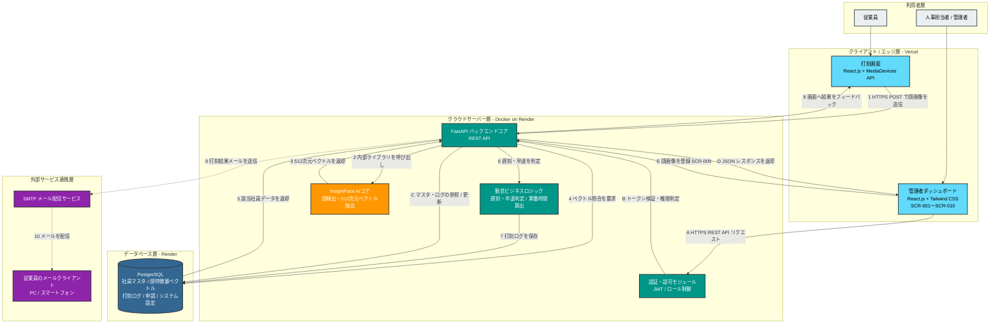
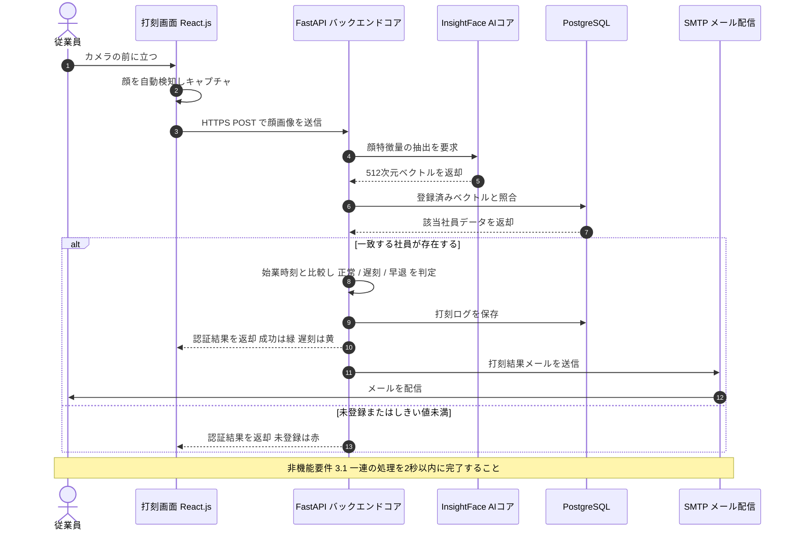
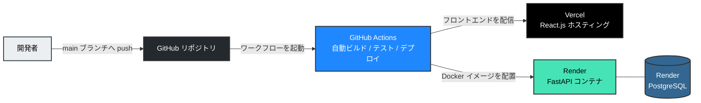

# システム構成図

**スマート勤怠管理システム（Kinetic HR）**

| 項目 | 内容 |
|---|---|
| 文書名 | システム構成図 |
| 関連文書 | 要件定義書 / フロントエンド基本設計書 / 画面詳細設計書 |
| 版数 | 2.0（改訂版） |

---

## 1. システム全体構成図

### 凡例

| 色 | レイヤー | 主な構成要素 |
|---|---|---|
| グレー | 利用者層 | 従業員、人事担当者・管理者 |
| 水色 | クライアント / エッジ層 | 打刻画面、管理者ダッシュボード（React.js / Vercel） |
| 緑 | クラウドサーバー層 | FastAPI、認証モジュール、勤怠ビジネスロジック（Docker / Render） |
| オレンジ | AI処理 | InsightFace 顔特徴量抽出エンジン |
| 紺 | データベース層 | PostgreSQL（Render） |
| 紫 | 外部サービス連携層 | SMTPメール配信、従業員のメールクライアント |

---

## 2. 打刻処理シーケンス図

---

## 3. デプロイ・CI/CD構成図

---

## 4. 補足事項

| No | 項目 | 内容 |
|---|---|---|
| 1 | 疎結合アーキテクチャ | フロントエンド（React.js）とバックエンド（FastAPI）はREST APIを介して通信する。将来的なデスクトップアプリ化の際は、クライアント層のみを差し替える構成とする。 |
| 2 | 認証・認可 | 管理者ダッシュボードへのアクセスはJWTトークンによる認証を必須とし、ロール（システム管理者 / 人事担当者 / 部門長）に応じて画面・機能単位でアクセスを制御する。打刻画面は認証不要とし、顔認証のみで本人識別を行う。 |
| 3 | 個人情報保護 | 顔特徴量ベクトルはPostgreSQL内に暗号化して保持し、外部からの直接アクセスを禁止する。顔画像そのものは保持しない。 |
| 4 | 通信保護 | クライアント・サーバー間の通信はHTTPSで保護する。要件定義書3.2に記載の「p2p通信のWireGuard暗号化」については、適用対象区間を別途確定のうえ本図に追記する（課題No.1）。 |
| 5 | 照合方式 | 要件定義書F-3-2に基づき、PostgreSQL内のベクトルとの直接照合、または事前学習済みSVMによる分類のいずれかを採用する。方式は精度検証の結果により決定する（課題No.2）。 |
